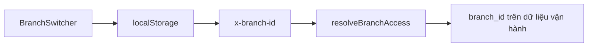

# Phân tích đa chi nhánh & đề xuất cải thiện

## Hiện trạng (đã có)

Multi-branch là gói **Enterprise** (199k + 79k/chi nhánh, tối đa 20 CN). Luồng cốt lõi:

| Đã có | Route / nền tảng |
|---|---|
| CRUD chi nhánh + phân công NV (kéo-thả) | [`/quan-ly-chuoi`](src/pages/quan-ly-chuoi.tsx) |
| Điều chuyển kho (tròng/gọng/thuốc/vật tư) | [`/dieu-chuyen-kho`](src/pages/dieu-chuyen-kho.tsx) |
| Tra cứu KH liên CN + chuyển hồ sơ | [`/tra-cuu-khach-hang`](src/pages/tra-cuu-khach-hang.tsx) |
| Báo cáo chuỗi (DT, đơn, BN, NV, trend) | [`/bao-cao-chuoi`](src/pages/bao-cao-chuoi.tsx) |
| Override giá theo CN (API) | [`api/branches/price-overrides`](src/pages/api/branches/price-overrides.ts) |
| Tổng quan tồn chuỗi (API) | [`api/branches/inventory-overview`](src/pages/api/branches/inventory-overview.ts) |

**Phạm vi dữ liệu:** bệnh nhân / đơn kính-thuốc / chờ khám / tồn số lượng = theo chi nhánh; catalog tròng (`HangTrong`) = dùng chung; gọng/thuốc = hybrid (shared hoặc theo CN); membership = tenant-wide, assignment = 1 CN active.

---

## Vấn đề tồn tại

### 1. Mô hình kho chưa thống nhất
- Migration sớm (V044) ghi chú kiểu KiotViet: **catalog dùng chung, tồn theo CN**.
- Thực tế: `GongKinh`/`Thuoc` vừa shared (`branch_id` null) vừa branch-owned; list thường lấy `null OR current` → dễ **trùng mã / lệch tồn / khó audit** khi nhiều cửa hàng.
- Chủ chuỗi thiếu màn hình “tồn theo chi nhánh” dù API `inventory-overview` đã có.

### 2. Giá theo chi nhánh “có backend, thiếu UI”
- `branch_price_overrides` đã apply khi `effective_price=1`, nhưng **không có màn hình quản lý** (sửa giá bán/giá vốn theo CN hàng loạt).
- Chuỗi kính thường cần: giá gọng/tròng khác nhau theo khu vực, khuyến mãi theo cửa hàng — hiện phải can thiệp catalog hoặc API.

### 3. Khách hàng & lịch sử đơn bị “cắt” khi chuyển CN
- Chuyển BN chỉ đổi *home branch*; **đơn cũ giữ nguyên CN cũ** (comment trong API).
- Nhân viên CN mới khó xem full journey (đơn kính cũ, số đo, bảo hành) nếu không biết dùng tra cứu liên CN.
- Chưa có khái niệm “khách chuỗi” (1 identity, nhiều lần mua ở nhiều cửa hàng) trên UI vận hành hàng ngày.

### 4. Nhân sự chuỗi còn mỏng
- `staff_attendance` (chấm công) = **feature flag + catalog**, chưa có UI.
- Chưa có ca làm / lịch trực / lương theo CN — trong khi chuỗi kính thường xoay NV giữa cửa hàng.
- 1 user = 1 assignment active → khó hỗ trợ “làm 2 cửa cùng ngày” hoặc quyền xem nhiều CN cho quản lý khu vực (ngoài owner/admin).

### 5. Báo cáo chuỗi còn nông so với nhu cầu kính
[`bao-cao-chuoi`](src/pages/bao-cao-chuoi.tsx) chủ yếu: doanh thu đơn kính/thuốc, số BN, NV, trend, phiếu điều chuyển.
Thiếu cho chuỗi kính:
- Tồn & vòng quay tròng/gọng theo CN (SKU hot, tồn chết)
- Tỷ lệ đơn “đặt tròng” vs có sẵn; lead time NCC
- Margin theo CN (cần giá vốn + override)
- Bảo hành / đổi trả / đơn sửa theo CN
- So sánh conversion: chờ khám → đơn kính

### 6. Print / vận hành cửa hàng chưa gắn chi nhánh
- Print Agent = theo máy PC, **không đăng ký máy in ↔ chi nhánh** trên cloud.
- `ten_cua_hang` trên cấu hình in ≠ entity chi nhánh → dễ in sai tên/địa chỉ khi NV chuyển máy hoặc dùng chung laptop.

### 7. Feature gating & sản phẩm chưa khớp docs
- Docs: `max_branches = 20`, addon 79k/CN; code `isMultiBranch` cứng `plan === 'enterprise'` (không qua `planHasFeature('multi_branch')`).
- Enterprise trong tài liệu ghi **chưa kích hoạt** (`is_active = false`) trong khi code/feature matrix đã sẵn — rủi ro go-to-market.
- Không thấy enforce `max_branches` rõ ràng trên UI tạo CN (cần kiểm tra khi implement).

### 8. Thiếu module gia công / lab chuỗi
- Chỉ có “tròng cần đặt” gắn `DonKinh`; **không có workflow cắt kính / lab trung tâm / gửi gia công giữa CN**.
- Chuỗi kính hay có 1 lab trung tâm phục vụ nhiều cửa — đây là khoảng trống lớn so với vận hành thực tế.

---

## Đề xuất cải thiện / thêm mới (ưu tiên cho cửa hàng kính)

### P0 — Lấp lỗ hổng đã có backend / gây sai lệch vận hành

1. **UI Tổng quan tồn chuỗi** — bind `inventory-overview`: tồn tròng/gọng theo CN, cảnh báo thấp, drill-down SKU.
2. **UI Giá theo chi nhánh** — quản lý `branch_price_overrides` (lọc SKU, import Excel, copy giá từ CN mẫu).
3. **Thống nhất mô hình kho** — chuẩn hóa: catalog shared + `*_stock` theo `branch_id`; migration/cleanup hàng `GongKinh`/`Thuoc` hybrid; cập nhật list API bỏ pattern `null OR branch`.
4. **Hồ sơ khách chuỗi trên vận hành** — từ BN/đơn kính: tab “Lịch sử toàn chuỗi” (read-only đơn + số đo các CN); chuyển CN không làm mất ngữ cảnh.
5. **In theo chi nhánh** — map `branches.ten_chi_nhanh` / `dia_chi_full` vào template in; tùy chọn đăng ký Print Agent theo `branch_id`.

### P1 — Nâng trải nghiệm chuỗi kính

6. **Điều chuyển kho thông minh** — gợi ý chuyển từ CN thừa → CN thiếu theo SKU (tròng theo độ); phiếu nháp từ cảnh báo tồn.
7. **Báo cáo chuỗi kính** — bổ sung: tồn/vòng quay, margin, tỷ lệ đặt tròng, top gọng/tròng theo CN, funnel chờ khám→đơn.
8. **Lab / gia công trung tâm** (MVP) — trạng thái đơn kính: `cho_gia_cong` → `dang_cat` → `san_sang` → `da_giao`; CN gửi lab (có thể = CN chính); tracking cho NV cửa hàng.
9. **Vai trò quản lý khu vực** — user được gán nhiều CN (xem/báo cáo), không chỉ 1 assignment; owner vẫn full.
10. **Chấm công tối thiểu** — check-in/out theo CN + thiết bị (tận dụng face device đã có `branch_id`).

### P2 — Mở rộng cạnh tranh phần mềm chuỗi

11. **Khuyến mãi / chương trình theo CN** — voucher, giảm giá theo cửa hàng.
12. **Đặt hàng NCC tập trung** — gộp “tròng cần đặt” nhiều CN → 1 PO; phân bổ về CN khi nhập.
13. **Bảo hành & đổi trả liên CN** — đổi kính ở CN khác cửa bán; audit theo chuỗi.
14. **Dashboard chủ chuỗi realtime** — DT hôm nay theo CN, alert tồn/điều chuyển pending (mobile-friendly).
15. **Giới hạn & billing CN** — enforce `max_branches`, UI mua thêm CN (addon 79k), đồng bộ `planHasFeature`.

---

## Nguyên tắc thiết kế đề xuất

- **1 identity khách / 1 catalog hàng** ở mức chuỗi; **tồn – đơn – ca – máy in** theo cửa hàng.
- Ưu tiên màn hình gắn vào hub đã có: [`quan-ly-chuoi`](src/pages/quan-ly-chuoi.tsx), [`quan-ly-phong-kham`](src/pages/quan-ly-phong-kham.tsx), [`bao-cao-chuoi`](src/pages/bao-cao-chuoi.tsx) — tránh phân tán menu.
- Mỗi tính năng user-facing mới cập nhật [`productFeaturesCatalog.ts`](src/lib/productFeaturesCatalog.ts) (nhóm `multi-branch` / `reports` / `patients`).

---

## Phạm vi tài liệu này

Đây là **phân tích sản phẩm + roadmap**, chưa phải spec implement. Bước tiếp theo sau khi bạn chốt: chọn 1–2 hạng mục P0 để viết plan kỹ thuật chi tiết (schema/API/UI).
