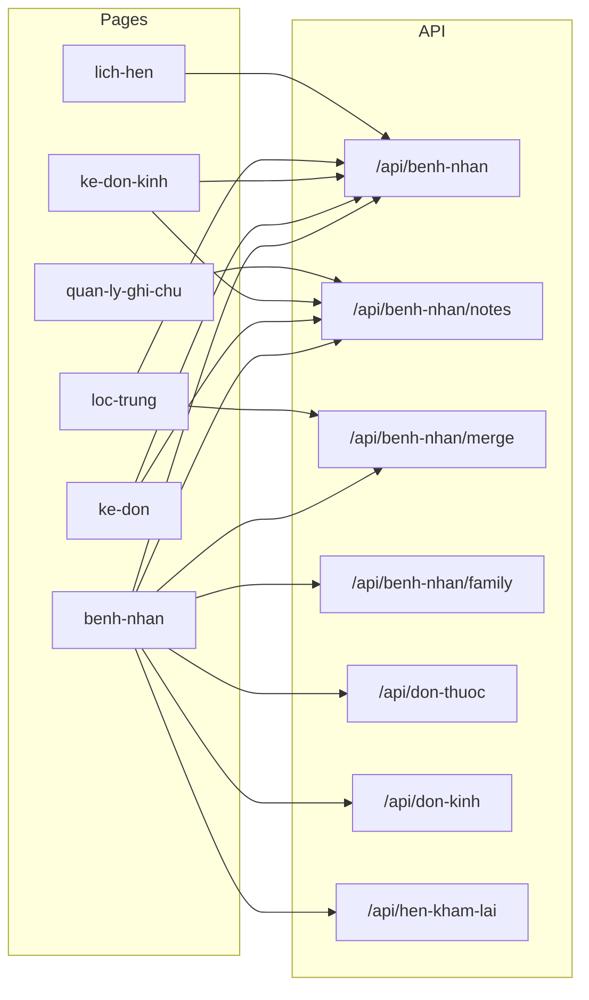

# Architecture — kedon-v3

Tài liệu khảo sát (read-only). Cập nhật khi thêm trang/API/module lớn. Agent: đọc file này trước khi đổi cấu trúc.

Stack: Next.js Pages Router, TypeScript, Tailwind, shadcn/ui, axios, react-hot-toast, Supabase (multi-tenant).

---

## 1. Pages (`src/pages/*.tsx`)

Route = tên file (kebab-case). `_app.tsx` là shell (Auth + Branch + axios interceptors). Login: `login.js`.

### Shell & auth

| File | Route | Mục đích |
|------|-------|----------|
| `_app.tsx` | — | App shell, auth, branch, mobile nav |
| `register.tsx` | `/register` | Đăng ký phòng khám |
| `offline.tsx` | `/offline` | PWA offline |

### Bệnh nhân & kê đơn

| File | Route | Mục đích |
|------|-------|----------|
| `benh-nhan.tsx` | `/benh-nhan` | CRUD BN, ghi chú, gia đình, gộp, hồ sơ đơn |
| `ke-don.tsx` | `/ke-don` | Kê đơn thuốc (`?benhnhanid=`) |
| `ke-don-kinh.tsx` | `/ke-don-kinh` | Kê đơn kính |
| `don-thuoc.tsx` | `/don-thuoc` | Danh sách đơn thuốc |
| `don-kinh.tsx` | `/don-kinh` | Danh sách đơn kính |
| `don-thuoc-mau.tsx` | `/don-thuoc-mau` | Mẫu đơn thuốc |
| `loc-trung.tsx` | `/loc-trung` | Phát hiện trùng + merge |
| `lich-hen.tsx` | `/lich-hen` | Lịch hẹn tái khám |
| `tra-cuu-khach-hang.tsx` | `/tra-cuu-khach-hang` | Tra cứu đa chi nhánh |
| `quan-ly-ghi-chu-khach-hang.tsx` | `/quan-ly-ghi-chu-khach-hang` | Inbox ghi chú BN |
| `tien-luong-ksct.tsx` | `/tien-luong-ksct` | Tiên lượng KSCT |
| `cham-soc-khach-hang.tsx` | `/cham-soc-khach-hang` | CRM (feature-gated) |

### Kho, báo cáo, chuỗi, vận hành

| Nhóm | Routes chính |
|------|----------------|
| Kho | `/quan-ly-kho`, `/quan-ly-kho-thuoc`, `/quan-ly-kho-gong`, `/danh-muc`, `/dieu-chuyen-kho`, `/tem-kinh` |
| Báo cáo | `/bao-cao`, `/bao-cao-super`, `/bao-cao-chuoi` |
| Chuỗi | `/quan-ly-chuoi`, `/gia-chi-nhanh`, `/ton-kho-chuoi`, `/dat-hang-ncc-chuoi`, `/khuyen-mai-chuoi`, `/bao-hanh-lien-chi-nhanh`, `/lab-gia-cong`, `/cham-cong` |
| Vận hành | `/nhac-viec`, `/thong-bao`, `/cau-hinh-in`, `/cai-dat-nhan-tin`, `/cai-dat`, `/quan-ly-phong-kham`, `/quan-ly-nguoi-dung`, `/quan-ly-vai-tro`, `/billing`, `/huong-dan`, `/tinh-nang` |
| Admin | `/admin` |
| Redirect | `/quan-ly-kinh` → kho gọng; `/tin-nhan` → thông báo |

---

## 2. API routes (tóm tắt)

Pattern chung: `requireTenant()` + branch access + `setNoCacheHeaders` + Supabase admin.

### Bệnh nhân (ưu tiên)

| Route | Methods | Params / body | Response | DB |
|-------|---------|---------------|----------|-----|
| `/api/benh-nhan` | GET/POST/PUT/DELETE | GET: `benhnhanid` hoặc `page`, `pageSize`, `search`; POST/PUT: ten, namsinh, …; DELETE `?id=` | `{ data }`, list có `total` + `tuoi` | `BenhNhan` (+ cascade) |
| `/api/benh-nhan/notes` | GET/POST/PUT/PATCH/DELETE | `benhnhanid`, `includeDeleted`, soft/hard delete | `{ data: notes[] }` | `patient_notes_simple` |
| `/api/benh-nhan/merge` | POST | `mainPatientId`, `patientIdsToMerge[]` | success + data | RPC `merge_patients` |
| `/api/benh-nhan/family` | GET | `benhnhanid` | FamilyGroup \| null | `family_*` |
| `/api/benh-nhan/search-for-family` | GET | `q`, `exclude_patient_id?` | hits[] | `BenhNhan`, `family_members` |

### Đơn & liên quan BN

| Route | Ghi chú |
|-------|---------|
| `/api/don-thuoc` | CRUD; GET theo `benhnhanid` / search / page |
| `/api/chi-tiet-don-thuoc` | Chi tiết dòng thuốc |
| `/api/don-kinh` | CRUD đơn kính + inventory |
| `/api/hen-kham-lai` | Lịch hẹn (`from`/`to`/`benhnhanid`) |
| `/api/dien-tien` | Diễn tiến theo `benhnhanid` |
| `/api/family-groups/*` | Nhóm gia đình CRUD + members |
| `/api/recent-activity` | Sync hoạt động gần đây (patient_id) |
| `/api/branches/patients` | Tra cứu/chuyển BN đa chi nhánh (không dùng route benh-nhan) |

### Nhóm API khác (ngắn)

`auth/`, `tenants/`, `branches/`, `dashboard/`, `ke-don/`, `inventory/*`, `bao-cao/`, `crm/`, `messaging/*`, `nhac-viec/`, `permissions/`, `roles/`, `print-agent/`, `admin/*`, `webhook/sepay`, `ghi-chu` (hệ thống — không phải patient notes).

---

## 3. Shared components / hooks / lib

### Lib quan trọng

| File | Mục đích | Ai dùng |
|------|----------|---------|
| `tenantApi.ts` | Auth tenant/branch API | hầu hết `pages/api` |
| `fetchWithAuth.ts` | fetch + Bearer/tenant/branch | một số trang (gồm benh-nhan một phần) |
| `apiClient.ts` / `apiAuthHeaders.ts` | Axios + interceptors | hầu hết pages |
| `patientSearch.ts` | `PatientResult`, `rankResults` | `usePatientSearch`, mobile nav |
| `patientSeed.ts` | Parse chuỗi quick-create | MobileBottomNav (PAB), benh-nhan |
| `patient/submitPatientForm.ts` | Validate + create/update BN dùng chung | benh-nhan actions, PAB quick create |
| `recentActivity.ts` | Log hoạt động local | benh-nhan, mobile nav |
| `utils.ts` | `capitalizeWords`, `searchByStartsWith` | benh-nhan |
| `productFeaturesCatalog.ts` | Catalog `/tinh-nang` | tinh-nang.tsx |

### Hooks

| Hook | Mục đích |
|------|----------|
| `usePatientSearch` | Debounce GET `/api/benh-nhan` + rank |
| `useMediaQuery` | Layout breakpoint (vd MobileBottomNav) |
| `usePermissions` / `useFeatureGate` | RBAC / plan |
| `useRecentActivityHub` | Timeline |

### Contexts

`AuthContext`, `BranchContext` (`isMultiBranch`), `FooterContext`, `PageTabsContext`, `TitleContext`. (`AuthContextNew` không được import.)

### Components liên quan BN

`FamilyCard`, `PatientSearchInput`, `components/ke-don/*` (in, media), `ProtectedRoute`.

---

## 4. Luồng dữ liệu bệnh nhân

| Consumer | CRUD BenhNhan | Notes | Family | Merge |
|----------|---------------|-------|--------|-------|
| `benh-nhan.tsx` | R/W + delete | full | FamilyCard | yes |
| `ke-don.tsx` / `ke-don-kinh.tsx` | R + PUT profile | R/W | Family UI | — |
| `loc-trung.tsx` | R bulk | — | — | yes |
| `lich-hen.tsx` | R search | — | — | — |
| `quan-ly-ghi-chu-khach-hang.tsx` | — | R/W branch-wide | — | — |
| `usePatientSearch` / MobileBottomNav (PAB) | R search + create nhanh | — | — | — (deep link `?new=1` vẫn hỗ trợ) |
| `tra-cuu-khach-hang` | qua `/api/branches/patients` | — | — | — |

**Create BN:** trang `/benh-nhan` (POST) và PAB (`QuickPatientCreateDialog` → `/api/benh-nhan`, rồi chọn kê kính / kê thuốc / ở lại tìm kiếm). Deep link `?new=1&quick_*` trên `/benh-nhan` giữ nguyên. **Update:** benh-nhan + ke-don + ke-don-kinh. **Delete:** chỉ benh-nhan.

---

## 5. Trùng lặp

- `interface BenhNhan` copy ở: `benh-nhan`, `ke-don`, `ke-don-kinh`, `loc-trung`, `tien-luong-ksct`, `api/benh-nhan/index`, cộng `BenhNhanData` trong print, `PatientSearchHit` song song `PatientResult`.
- `calcAge` / `calcPatientAge` / `calcAgeFromNamsinh` / `familyUtils.calcAge` — nhiều biến thể.
- Pattern axios `?_t=Date.now()` + Cache-Control không đồng nhất (`usePatientSearch` chỉ header).
- HTTP: axios (phổ biến) vs `fetchWithAuth` (một số chỗ).

---

## 6. Bất nhất quan trọng

| Vấn đề | Chi tiết |
|--------|----------|
| `PatientResult` vs `BenhNhan` | Search subset vs hồ sơ đầy đủ; chưa có `src/lib/patient/types.ts` (đích refactor) |
| `id` optional | `loc-trung` / form create vs bắt buộc trên API |
| `tuoi` | List API có; detail GET không; UI tự tính sau save |
| `namsinh` | string `yyyy` hoặc `dd/mm/yyyy` |
| Appointment naming | API `hen-kham-lai`, page `lich-hen` |
| Notes | `/api/benh-nhan/notes` ≠ `/api/ghi-chu` (hệ thống) |

---

## Mục tiêu refactor trang BN

Tách `src/pages/benh-nhan.tsx` (~2617 dòng) → `src/components/benh-nhan/` + `src/lib/patient/`, page chỉ re-export. Chi tiết: `docs/REFACTOR_PLAN.md`.
